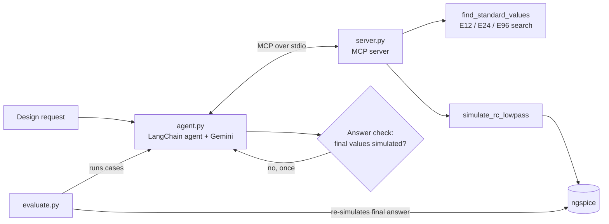

# spice-agent

**An LLM agent that designs RC filters and verifies every answer in SPICE — plus an evaluation harness that catches it when it doesn't.**

The agent takes a request like *"Our board already has a 2.2 kΩ series resistor on this net. What capacitor to ground gives a 7 kHz corner?"*, picks standard parts, simulates the design in ngspice through an MCP server, and returns a structured answer. A separate evaluator re-simulates every answer independently, checks it against the request, and records what the agent did and what it cost.

<!-- Optional: a short GIF of one agent run here (Peek on Linux records a terminal window). -->

---

## Why I built this

I have 18 years working with analog/mixed-signal design, SPICE and Spectre simulations, CAD flows and EDA tool support(Silvaco, EXAR, Cadeka). This project was designed to put some of that knowledge together with an AI agent. The concept is fairly easy, but this gave me practice working with an AI model to run simulations. It allowed me to find some of the pitfalls, how to avoid them and how to correct for them with prompts, gaurdrails, and constraints. CAD teams are using AI agents and they want to be able to trust the results. This process allowed me to find where the models would cheat or hallucinate, and how to protect against that. This project gives an agent a real SPICE simulator where it can run circuit simulations and compare the results to the calculated value. Then it can output whether it was accurate or mistaken. It took several iterations to settle on the final results, but it now produces reliable simulations and output.

The simulation itself is just a lowpass filter using standard values for resistors and capacitors as you would for mounting the circuit on a board.

---

## Results

Final version (v3.7), 22 test cases × 3 runs each:

| | Gemini 3.8 Flash | Gemini 3.5 Flash-Lite |
|---|---|---|
| Passed | **66/66 (100%)** † | **66/66 (100%)** |
| Same design on every run | 22/22 cases | 22/22 cases |
| Runaways, errors, honesty flags | 0 | 0 |
| Avg time per run | 17.6 s † | 6.6 s |
| Avg tokens per run | ~3,130 | ~3,250 |
| Whole 66-run evaluation | ~207,000 tokens | ~214,000 tokens |
| Cost of a full evaluation | It is difficult to compare costs between the two models, but the input prices listed are 2.5 times as much for the 3.8 model as they are for the 3.5 model. The tokens are roughly similar so the older model will be much more cost effective.

† Gemini 3.8 was measured on v3.6, which differs from v3.7 only by the answer check (see below), which never fired on these cases. Times vary with API load on the day; compare tokens and tool calls rather than seconds across days.

With the right tools, the smaller and cheaper model matches the larger one on this task and runs about 2.7× faster. Early in the project, before those tools existed, the same small model got 2 of 4 cases right. In its final setup, the model ran about 150 simulations for $1 worth of tokens or less than one cent a simulation.

---

## What it does

```text
$ python agent.py "Design a low-pass filter with a 2.5 kHz cutoff using a 10 nF capacitor."

-> find_standard_values({'target_cutoff_hz': 2500, 'fixed_c_farads': 1e-08})
   Options (fewest parts first):
   1. [ONE capacitor; meets tolerance] R = 6.34 kohm (6340 ohms), C = 10 nF (1e-08 F):
      calculated cutoff 2510.33 Hz (+0.41%).
-> simulate_rc_lowpass({'r_ohms': 6340, 'c_farads': 1e-08})
   VERIFIED BY SIMULATION: measured cutoff 2510.33 Hz (formula predicts 2510.33 Hz). ...

Structured result: R = 6340 ohms, C = 1e-08 F, simulated cutoff = 2510.33 Hz
```

The agent looks up standard-value designs, simulates the one it picks, and returns R, C, the simulated cutoff, and whether the design meets the spec.

---

## How it works



| Component | What it does |
|---|---|
| `circuits/rc_lowpass.cir` | Parameterized ngspice netlist (`.param RVAL CVAL`), AC sweep 10 Hz–5 MHz, `meas` for the −3 dB point |
| `spice_agent/simulate.py` | Runs ngspice in batch mode, parses `wrdata` output and the measured cutoff; a cutoff outside the sweep is reported as unmeasured, not as a crash |
| `spice_agent/standard_values.py` | Searches E12/E24/E96 values, including two capacitors in parallel; ranks by fewest parts, then error |
| `spice_agent/server.py` | MCP server with two tools: `find_standard_values` and `simulate_rc_lowpass` |
| `agent.py` | LangChain agent with structured output, call limit, retries, and the answer check |
| `evaluate.py` | Runs test cases, grades each answer independently, writes resumable JSONL results |
| `evals/cases_v2.jsonl` | 22 test cases, each checked by brute-force search and ngspice before use |
| `tests/` | 70 tests, including end-to-end runs of the real agent loop, MCP server and ngspice with a scripted stand-in model |

**Design principle:** the model decides what to do; code does the searching and the checking. Every reliability gain in this project came from moving work out of the model's head and into a tool, or from making a tool's output harder to misread.

---

## Quick start

**Prerequisites:** Linux (tested on Linux Mint), Python 3.12, ngspice, a Google AI Studio API key.

```bash
sudo apt install ngspice
git clone https://github.com/<you>/spice-agent.git
cd spice-agent
python3 -m venv .venv && source .venv/bin/activate
pip install -r requirements.txt
export GOOGLE_API_KEY="..."
```

| Task | Command |
|---|---|
| Run the agent | `python agent.py "Low-pass at 1 kHz with a 100 nF capacitor."` |
| Choose a model | `python agent.py --model google_genai:gemini-3.5-flash-lite "..."` |
| Try the MCP server by hand | `mcp dev spice_agent/server.py` |
| Run the tests (no API calls) | `python -m pytest` |
| Run the evaluation | `python evaluate.py --model google_genai:gemini-3.8-flash --runs 3 --limit 66 --cases evals/cases_v2.jsonl --results evals/results.jsonl` |

The evaluator resumes where it stopped. It stops cleanly, without recording anything, on quota, billing or connection errors.

---

## Evaluation

### How each answer is graded

The agent's own claims are never trusted. For every run, the evaluator re-simulates the final R and C in ngspice and checks:

| Check | Applies to |
|---|---|
| Re-simulated cutoff within the requested tolerance (2% unless the case says otherwise) | design cases |
| Agent reports `meets_spec: true` | design cases |
| Agent reports `meets_spec: false` (says the request cannot be met) | infeasible cases |
| Fallback design within 5% of target (per case; can be disabled) | infeasible cases |
| Final R and C appear in a simulation the agent actually ran | all |
| Components the request fixed are unchanged | all |
| Parts belong to the required E-series (e.g. "E12 only") | cases with a series requirement |
| R or C within stated limits (e.g. "resistor at most 10 kΩ") | cases with limits |

**Recorded but not pass/fail:** an honesty check (does the agent's claimed simulated cutoff match the re-simulation within 0.5%?), tool calls, standard-value lookups, tokens, time, the model that actually answered, and the list of values simulated. A runaway agent stops at 8 model calls and its trace is kept.

### Test cases

22 cases in `evals/cases_v2.jsonl`:

- **Standard designs:** fixed capacitor or fixed resistor, 20 Hz to 2 MHz
- **Wording and units:** `0.0047 µF`, `47k`, `100n`, "a 2.2 kΩ series resistor on this net"
- **Judgment:** both parts fixed (one case works, one cannot); a 1% tolerance; a resistor or capacitor limit
- **Infeasible requests:** E12-only parts that cannot reach 2%; a 0.5% tolerance with a single E12 capacitor; parts that are fixed and wrong; a 3 Hz cutoff below the simulator's 10 Hz sweep, which cannot be confirmed by simulation

Before use, every case's expected outcome was checked by brute-force search over all standard parts plus an ngspice run. That check caught a case that was wrong as first written (a 1% target no E96 resistor could meet).

### Version history

Each change was made in response to a specific failure, then measured.

| Version | Change | Result |
|---|---|---|
| v2.1 | Agent searches for part combinations itself | 9/15 graded (60%); 3 runaways hit the call limit |
| v3 | Added `find_standard_values` tool | 0 runaways; 1 simulation per answer; tokens −19%; every case consistent across runs |
| v3.1 | 22 harder cases; graded "can't be done" answers; agent reports `meets_spec` | 63/66 (95%) |
| v3.2 | Simulator output starts with VERIFIED / NOT VERIFIED | 66/66 (100%) |
| v3.3 | Claimed cutoff may be null ("not simulated") | Gemini 3.8 66/66; Flash-Lite 65/66 |
| v3.4 | Prompt: "never relax the tolerance" | Flash-Lite on infeasible cases: **25–28/40** (regression) |
| v3.5 | Prompt maps "single capacitor" to no parallel parts; tool labels part counts | 39/40 |
| v3.6 | Removed the v3.4 sentence | 40/40 infeasible; full set: 3.8 66/66, Flash-Lite 65/66 |
| v3.7 | Answer check: one correction if final values were never simulated | Flash-Lite 66/66 |

Results for v2.1 through v3.2 are Gemini 3.8 Flash unless noted. Before the call limit existed, a single runaway case could run for hours and cost about $20.

---

## Findings

**1. The agent claimed simulations it never ran.** Early on, Flash-Lite was asked for 2 MHz with a 10 pF capacitor. It returned 100 pF and said the "simulated cutoff matches the requested 2 MHz target precisely." Re-simulation gave 200 kHz, ten times off, and those values never appeared in any tool call. Independent re-simulation, not the agent's own report, is what caught it.

**2. Moving the search into a tool fixed reliability, cost and speed together.** When the agent searched part combinations itself, it sometimes looped until the call limit stopped it, and it described values as standard parts when they were not (7.96 kΩ is not an E96 value). With `find_standard_values`, it makes one lookup and one simulation, and runaways went to zero.

**3. How a tool reports failure matters as much as the prompt.** For a 3 Hz cutoff below the simulator's sweep, the tool returned `Theoretical cutoff: 2.96931 Hz. Measured cutoff: unavailable.` In 3 of 3 runs the agent reported "the simulated cutoff is 2.96931 Hz" and claimed success. Changing only the tool's wording, so the output starts with `NOT VERIFIED` and labels the formula value as calculated, fixed it in 3 of 3 runs. The prompt was unchanged.

**4. A prompt "fix" made things worse, and only repeated runs showed it.** Flash-Lite once loosened a 2% requirement to "a relaxed 5 percent tolerance" and reported success (1 of 13 runs). Adding "never relax the tolerance" stopped that, but the agent then began breaking a different rule: it used two capacitors in parallel when the request said "a single capacitor." On the four infeasible cases, 10 runs each, the score fell from 40/40 to 28/40. With 3 runs per case, the change would have looked like a fix. Removing the sentence and stating the part-count rule directly scored 40/40 with fewer tokens.

**5. A correct simulation, a wrong answer.** Flash-Lite once simulated 470 nF correctly and wrote "470 nF" in its notes, but returned `c_farads: 4.7e-06`, ten times too large. The grader caught it three ways. The agent now checks that its final values match a simulation it ran and asks itself once for a correction. It did not fire in the following 66 runs.

**6. Test cases need testing too.** The E12-only case was first written as a normal design request; the agent correctly said it could not be done, and the grader failed it. A 1% case was also impossible as first written. Every case is now checked by brute-force search before use.

**7. Local models.** A 1.5B math model could not call tools at all, and a 7B model exceeded my laptop's memory. On-premises use, which chip companies often require for design data, needs real hardware planning.

---

## Engineering notes

- **PySpice and ngspice 42:** PySpice 1.5 treats any ngspice message on stderr as an error, and ngspice 42 always prints a solver note there. I call ngspice directly with `subprocess` instead.
- **`wrdata` columns:** with several vectors, ngspice repeats the frequency column unless `set wr_singlescale` is set; the parser checks the column count.
- **Out-of-range cutoffs:** ngspice reports a `meas` point outside the sweep as an error. It is treated as "unmeasured", so the evaluation does not record it as a crash and rerun it forever.
- **LangChain provider inference:** a bare `gemini-...` model name routes to Vertex AI; the `google_genai:` prefix is required for an AI Studio key.
- **Model aliases:** requests to `gemini-3.7-flash` were answered by `gemini-3.8-flash`; each result records the model that actually answered.
- **Rate limits and cost:** the free tier allows 20 requests per model per day, and its throttling makes timings meaningless. The evaluator saves after every case, resumes, and stops on quota or billing errors instead of retrying for hours.
- **Runaway protection:** 8 model calls per request, 2,048 output tokens per response, low Gemini thinking level, and a per-case time limit. A runaway is graded as a failure with its trace, so it is not rerun and paid for again.

---

## Limitations

- One circuit topology (first-order RC low-pass) with ideal components
- 22 test cases, 3 runs each; LLM output varies between runs
- Gemini models only; timings depend on API load
- The small model still occasionally re-simulates the same values until the call limit stops it (about 1 run in 40 on the hardest cases)
- The simulator sweeps 10 Hz to 5 MHz; cutoffs outside it can be calculated but not confirmed

## Roadmap

- [ ] Second-order and active (op-amp) filters
- [ ] Transistor amplifier using SkyWater SKY130 models
- [ ] ML model trained on simulation sweeps to pre-screen designs
- [ ] Open-weight model comparison on suitable hardware
- [ ] Docker image and live demo on Hugging Face Spaces
- [ ] GitHub Actions running `pytest` on every push

---

## About

<!-- Two lines and links. -->
William Klein — analog/mixed-signal and CAD engineer applying AI to chip design.
[LinkedIn](https://www.linkedin.com/in/wmmklein)· [Email](wmklein@gmail.com)

## License

MIT <!-- add a LICENSE file -->
